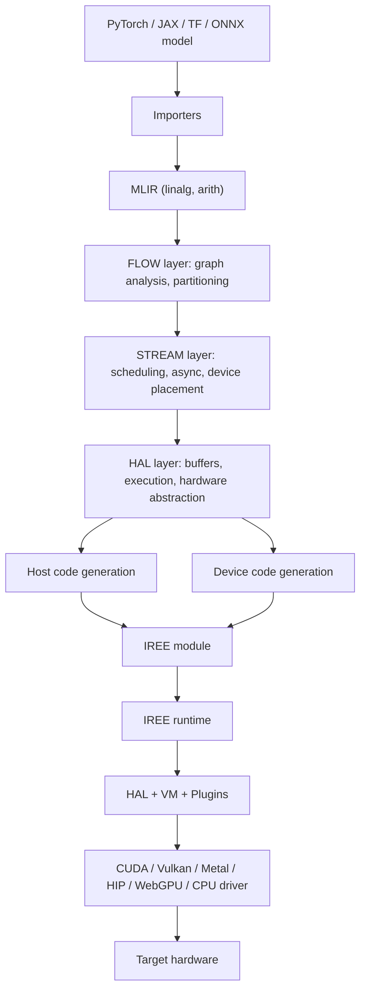

# Brief 4 — IREE Runtime Orchestrator: documentation

## Table of contents

1. [What Brief 4 actually asks for](#what-brief-4-actually-asks-for)
2. [What is IREE?](#what-is-iree)
3. [IREE architecture](#iree-architecture)
4. [The pipeline, stage by stage](#the-pipeline-stage-by-stage)
5. [Progress so far, and what's next](#progress-so-far-and-whats-next)

---

## What Brief 4 actually asks for

Take a small PyTorch model → lower it to IREE-runnable 
form (.mlir → .vmfb, using existing tooling) → write/generate 
the minimal C/C++ host code that uses IREE's high-level 
runtime API (not low-level HAL buffers/semaphores) to load, invoke, 
and read results → validate it against a provided mock/stub 
runtime, and against the real PyTorch output for numerical correctness. 
No custom hardware, no hand-written low-level dispatch.

## What is IREE?

 IREE is an MLIR-based compiler and runtime system. The compiler turns machine learning models into optimized executable modules, and the runtime loads those modules, feeds them input tensors, executes them on the target device, and returns the results.

## IREE architecture

### 1. Architecture overview

Three components carry the entire system: the **compiler**, the **module**, and the **runtime**. Everything else — flow, stream, HAL, the codegen backends, the drivers — is a part living inside one of those three. A model goes in one end as a framework-specific program and comes out the other end as compiled code running on real hardware, and every stage between those two points exists to progressively strip away framework-specific and hardware-specific detail, then add hardware-specific detail back in, deliberately, only once, at the very end.

(worth mentioning here that  each of the passes that happen are actually dilects and mention there too like flow dilect/stream dilect ..)

### 2. Model import & MLIR

**Input:** a model from PyTorch, ONNX, JAX, TensorFlow, or a custom plugin importer.
**Output:** MLIR in the `linalg` and `arith` dialects.

Each framework has its own importer, and each one converts that framework's own operation set into the same common target: generic structured tensor operations (`linalg`) and generic arithmetic (`arith`), with no trace of the source framework's own naming left in it. (do not ist convert into filect like torch-mlir before transformning into linalg/arith)

### 3. Flow layer

**Input:** the imported MLIR.
**Output:** the same computation, split into dispatch regions, with the data dependencies between those regions made explicit as a graph.

A dispatch region is the chunk of work IREE will eventually hand to a device as one unit — not unlike a single GPU kernel launch or a single CPU task. Flow's job is deciding where those boundaries go: which operations get fused together into one region, and which get split apart. It answers exactly one question — what produces which data, and what consumes it .
### 4. Stream layer

**Input:** the dispatch regions and dependency graph from flow.
**Output:** an explicitly scheduled, asynchronous program.

Where flow knows *what depends on what*, stream decides *how execution actually happens*: memory gets allocated for each region's inputs and outputs, dispatches get ordered and assigned to run concurrently wherever the dependency graph allows it, and explicit synchronization points get inserted wherever one region genuinely has to wait on another. This is also where a computation gets assigned to a specific device, if more than one is available.

### 5. HAL layer

**Input:** the scheduled stream program.
**Output:** command buffers and device executables.

HAL — the hardware abstraction layer — is the one representation every backend plugs into, so a CPU target and a GPU target don't require the compiler to fork into separate paths. It produces two things together: **command buffers**, host-side sequences describing what to execute and in what order, and **device executables**, the compute itself, described uniformly regardless of which device will eventually run it. Buffers, devices, and synchronization are all modeled here in backend-neutral terms — `hal.buffer`, `hal.device`, `hal.executable`, `hal.fence` — and stay neutral right up until code generation gives them a real target.

Worth knowing: this isn't a strictly one-directional pipeline. Target configuration and profiling feedback loop back into flow, stream, and HAL — how work gets partitioned, scheduled, and buffered can be shaped by what a specific target actually supports and by how earlier runs actually performed, not only by the input program considered in isolation.

### 6. Code generation

**Input:** command buffers and device executables from HAL.
**Output:** real compiled code, generated along two separate, parallel paths.

**Host code generation** compiles the command-buffer side into code that runs on the host and drives execution — through LLVM, direct C emission, or IREE's own VM bytecode format, targeting a CPU or WebAssembly. This path barely changes based on which device the compute ultimately runs on; its job is orchestration, not computation.

**Device code generation** compiles the executable side into the actual compute, and this path is entirely target-specific: LLVM for native CPU instruction sets (ARM, RISC-V, x86) and for GPU instruction sets reached through LLVM backends (PTX for CUDA, ROCDL for AMD/HIP), SPIR-V for Vulkan, or VMVX — IREE's own portable, software-only execution format for targets without native code generation support at all.

### 7. Modules & runtime

**Input:** the generated host code and device code.
**Output:** a single compiled artifact, in one of four formats — VM bytecode, C source, a static library, or a shared library.

VM bytecode, packaged as a `.vmfb` file, is the common case and the format this brief works with directly. The others exist for deployment situations where dynamic module loading isn't available, such as small embedded targets. Whichever format is used, the module is tied to the backend it was generated for — the same source model compiled for CPU and for CUDA produces two different, non-interchangeable files.

At runtime, the module is loaded by two internal layers working together. The **VM** interprets its bytecode: resolving and dispatching function calls, managing loaded modules, exposing reflection information about them. The **HAL**, now doing real work instead of just providing a compile-time abstraction, hands actual compute off to whichever **driver** is active for the current backend. **Plugins** sit at both the top level of the runtime and inside the HAL specifically, as an extension point for adding capability without touching the runtime's core. The whole thing is deliberately small — IREE's own documentation puts a typical build at roughly 25 to 150 KB, the direct payoff of how much work the compiler already finished ahead of time.

### 8. Runtime backends & deployment

**Input:** a loaded module and a chosen backend.
**Output:** execution on real target hardware.

A **driver** exists per backend — CPU, CUDA, Vulkan, Metal, HIP, WebGPU — and each one implements the same HAL interface against genuinely different hardware underneath: a CPU driver manages a thread pool and runs natively compiled code directly; a CUDA driver manages GPU device memory and launches compiled PTX kernels through NVIDIA's driver API; Vulkan and Metal drivers do the equivalent through their own respective graphics/compute APIs. Swapping which backend a program targets is, in principle, a matter of swapping which driver gets asked for — nothing about the VM or the module's host code needs to change.

Two things sit beside the runtime rather than inside it. **Tools** — `iree-run-module`, `iree-check-module`, `iree-benchmark-module` — are command-line utilities for running, testing, and benchmarking a module without writing any host code at all. **Bindings** — C, Python, Rust, TFLite, or a custom binding — are the language-level interface an application actually links against. This brief's orchestrator is written directly against the C bindings (`iree_runtime_*`); the Python `iree.runtime` package used earlier in this project's pipeline scripts wraps that same C layer underneath.

## The pipeline, stage by stage

The architecture above, walked once as a single worked example — a PyTorch model compiled for two backends at once, so the host/bytecode side and a real GPU device side can both be followed through to the end:

**Up to HAL, there's only one path.** The model gets imported, its signature rewritten to `hal.buffer_view`, split into dispatch regions by flow, scheduled by stream, and turned into command buffers and device executables by HAL — identically, regardless of what hardware it will eventually run on. Nothing backend-specific has happened yet.

**At code generation, the path splits into two, and stays split all the way to the end.**

*The bytecode path (always the same, regardless of target device):* host code generation takes the command-buffer side and compiles it into VM bytecode — the instructions that will drive execution, decide which dispatch runs when, and marshal data in and out. This code doesn't know or care whether the eventual compute happens on a CPU or a GPU; its entire job is orchestration, and it looks the same either way.

*The device path (concretely, for an NVIDIA GPU target):* device code generation takes the executable side and, because the target backend was set to CUDA, routes it through LLVM's PTX backend — producing real compiled GPU kernel code, not a hardware-agnostic description anymore. This PTX code and the host bytecode from the other path both get packaged into the same IREE module.

At runtime, the two paths reunite. The **VM** loads and interprets the host bytecode — and when it reaches a dispatch instruction, it doesn't execute anything itself. It hands that instruction to the **HAL**, which for a CUDA target means the **CUDA driver**: allocating GPU memory, copying inputs across, launching the embedded PTX kernel through NVIDIA's driver API, and copying the result back once the GPU signals it's done. Swap the target backend to CPU instead, and the bytecode path is untouched — only the device path and which driver the HAL hands off to would change.

Everything from module-loading onward is already generic in the orchestrator built for this brief, driven by a small signature describing each model's inputs and output rather than by anything hardcoded — proven by running two structurally different models (a matrix multiply and a scalar-output loss function) through the identical compiled binary, differing only in which signature gets passed in. The device-driver side of this diagram — actually targeting CUDA or the eventual simulated hardware, rather than the CPU driver used so far — is not yet built.

## Progress so far, and what's next

**Environment.** Started by fixing a broken venv — an old `iree-runtime` pip package and the current `iree-base-runtime` package had both installed files into the same `iree.runtime` namespace directory, silently corrupting each other. Removed the stale one, reinstalled clean.

**Building from source.** Cloned IREE shallow, without the LLVM submodule, and built a runtime-only static library (`libiree_runtime_unified.a`) with only the CPU HAL drivers enabled. Hit and fixed the compiler/runtime version-mismatch bug described above by pinning the source checkout to the exact commit the pip compiler was built from.

**Understanding the pipeline.** Walked the full dialect stack on a real model using `iree-compile --compile-to=<stage>`, keeping the intermediate `.mlir` files as reference. Read IREE's own `simple_embedding` sample and `demo.cpp` to see the raw `iree_vm_*`/`iree_hal_*` calls that the high-level `iree_runtime_*` API wraps.

**Building the orchestrator.** Started from a hand-adapted copy of IREE's own runtime demo, generalized incrementally: first a parameterized `run_matmul(session, A, B, C, M, N, K)` replacing hardcoded test constants, then a reusable `make_input_buffer_view` helper taking shape and rank as real parameters instead of literals. Found and fixed several real bugs along the way worth remembering — a forward-declaration/definition parameter-order mismatch that compiled cleanly and produced correct output for weeks because every test case happened to have `M == N == K`, and only broke on a genuinely non-square test; a `const`-qualifier mismatch between a function's declaration and definition that the linker caught but the compiler didn't; a struct literal missing an explicit field (`num_inputs`) that silently defaulted to zero and produced "expected N arguments but passed 0" at runtime.

**Generalizing.** Replaced the single hardcoded `run_matmul` with a `Modelsignature`-struct-driven generic `run_model`, then extended it further from a fixed 2-input design to a variable-count design (`inputs[8]` + `num_inputs`), driven by hitting a real 3-input model (a linear-layer-plus-MSE loss) that the fixed-2 design couldn't express.

