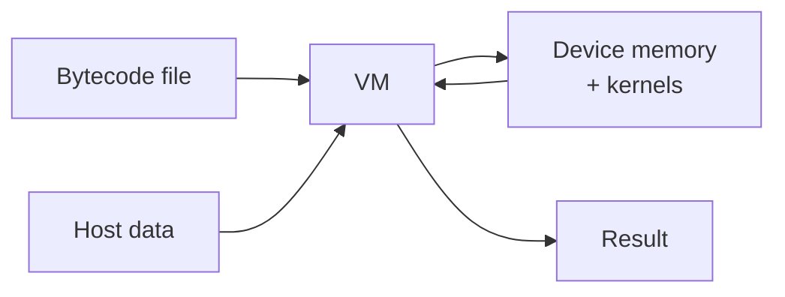
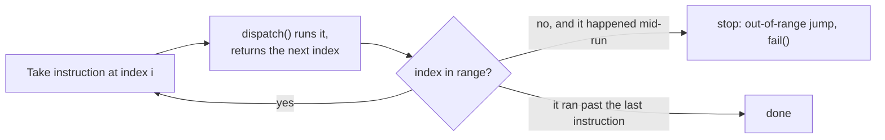
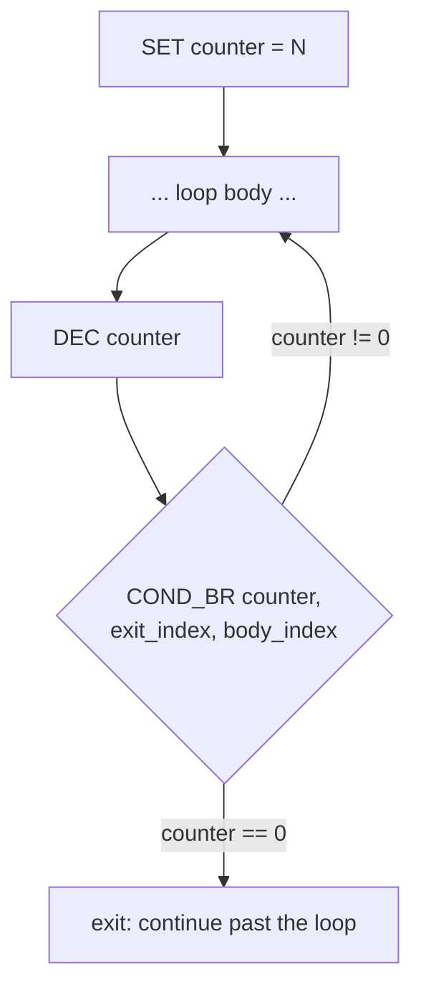
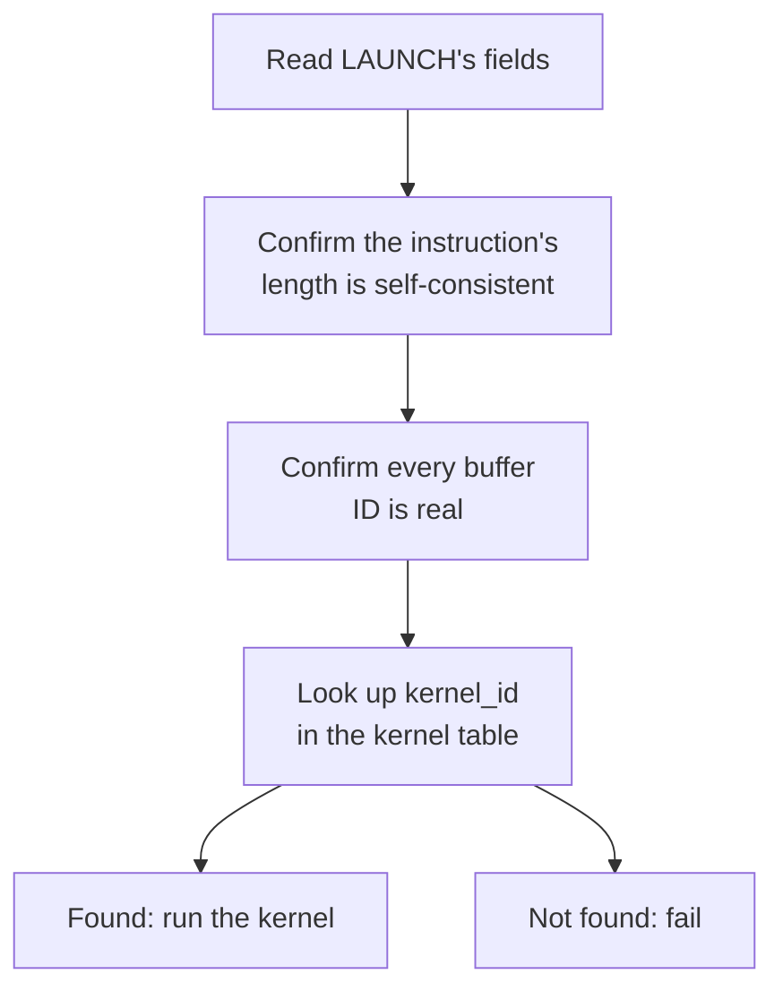

# A custom bytecode VM runtime

**A virtual machine that reads a hand-written bytecode file, interprets it instruction by instruction, and calls the real device APIs needed to hand heavy compute off to a GPU.**

This doc covers the bytecode format, how the interpreter turns a text file into real device memory and real kernel launches, and where it maps onto IREE's own architecture. No compiler exists here on purpose — the bytecode is written by hand, in plain text files. What's actually being built and tested is the runtime underneath it.

## Table of contents

1. [Mapping onto IREE](#mapping-onto-iree)
2. [What's implemented, at a glance](#whats-implemented-at-a-glance)
3. [Bytecode instruction set](#bytecode-instruction-set)
4. [Architecture](#architecture)
   - [4.1 Overview](#41-overview)
   - [4.2 Parsing the file](#42-parsing-the-file)
   - [4.3 Checking sizes before anything runs](#43-checking-sizes-before-anything-runs)
   - [4.4 Setting up input](#44-setting-up-input)
   - [4.5 Running the instructions](#45-running-the-instructions)
   - [4.6 Registers and indirect addressing](#46-registers-and-indirect-addressing)
   - [4.7 Control flow: BR and COND_BR](#47-control-flow-br-and-cond_br)
   - [4.8 Launching a kernel](#48-launching-a-kernel)
   - [4.9 Reading the result back](#49-reading-the-result-back)
5. [Limitations](#limitations)
6. [Future direction](#future-direction)
7. [File structure](#file-structure)

## Mapping onto IREE

| IREE's version | This project's version |
|---|---|
| `.vmfb`'s VM bytecode section | A hand-written bytecode file, plain text |
| IREE's compiler, producing that bytecode | Not built. Bytecode is authored directly, by hand |
| IREE's VM interpreter | A VM/interpreter, built from scratch, that reads the bytecode file |
| IREE VM's register/value list, used to carry state between instructions | This VM's own register file — a plain, growable array of ints |
| IREE VM's single branch primitive (its loops and conditionals are both built from just this) | `BR` / `COND_BR` — the same idea: jump forward or backward, optionally testing a register first |
| HAL — hardware-independent control flow, backend-specific executables underneath | `src/hal/device.h`'s abstract `Device` interface: `allocate`/`free`/`upload`/`download`/`dispatch`, implemented separately per backend |
| A driver (e.g. the CUDA driver) | `CudaDevice` (`src/hal/cuda_device.{h,cpp}`) — wraps real CUDA calls behind the `Device` interface |
| A compiled `hal.executable` (device machine code) | Real CUDA kernels (`vec_mm_Kernel`, `vec_add_Kernel`, `relu_Kernel`, `bias_add_Kernel`), what a CUDA-targeted `LAUNCH` instruction points at |

## What's implemented, at a glance

The first version of this VM could only run a straight-line list of five instructions: allocate memory, copy data in, launch one of two kernels, copy data out, free memory. Since then, three real capabilities have been added on top of that:

- **Registers.** A small, growable array of integers the bytecode can read and write (`SET`, `INC`, `DEC`). This is what makes anything below possible — without somewhere to keep a running value, there's no way to count, loop, or make a decision.
- **Indirect addressing.** Any numeric operand in the bytecode — a buffer id, an input slot, even a `LAUNCH` argument — can be written as `@N` instead of a plain number, meaning "read register `N` right now and use that." The same line of bytecode can then touch a different buffer or slot on every pass through a loop.
- **Control flow.** `BR` (unconditional jump) and `COND_BR` (jump based on whether a register is zero). Together with registers, this is enough to build real loops — proven end to end in `examples/bytecode12.txt`, which runs a two-layer network by looping the same three-kernel block twice, picking each layer's own weights and bias through register-indexed buffer arguments.

Two more kernels were also added (`relu_Kernel`, `bias_add_Kernel`, on top of the original matmul and vector-add), and kernel chaining was proven: a kernel's output buffer can feed straight into the next kernel's input, with no host round trip in between.

Since then, a second, larger change has landed: **the VM no longer talks to CUDA directly.** Every hardware call — allocate, free, upload, download, launch — now goes through an abstract `Device` interface (`src/hal/device.h`), with CUDA's own logic relocated, unchanged in behavior, behind a `CudaDevice` implementation of it. A second implementation, `EmunpuDevice`, wraps `emunpu-sim` (a separately-built, simulated multi-core NPU, plain C, no GPU required) behind that same interface. The VM itself never knows which one it's talking to.

That second implementation has been run, not just built: `examples/bytecode12_emunpu.txt` (the same two-layer network as `bytecode12.txt`, with only its `LAUNCH` lines rewritten for emunpu's shape) produced `0 0 8 0` end to end via `src/main_emunpu.cpp` — the correct result. The CUDA side of the same comparison is still assumed correct rather than confirmed the same way, since this environment has no CUDA GPU to run it on. Full design reasoning — why this shape, what was tried and dropped, what's still open — lives in [`hal-design.md`](../bytecode-vm/hal-design.md); this doc covers what's actually built.

The rest of this doc describes the instruction set and pipeline in detail; §7's file structure reflects the current `hal/` split.

## Bytecode instruction set

Eleven opcodes now, not five. Every instruction is still one line: a name, then whitespace-separated operands. The VM doesn't know what a program "means" — it just runs these in order (or jumps, when told to).

### Memory and host transfer

| Instruction | Operands | What it does |
|---|---|---|
| `ALLOC` | `size` | Allocates a device buffer of `size` bytes. The VM hands out the next free buffer ID (0, 1, 2...) on its own, and later instructions refer back to it by that number. |
| `FREE` | `buffer_id` | Releases the device buffer at `buffer_id`. |
| `COPY_H2D` | `buffer_id`, `input_slot`, `size` | Copies `size` bytes from an input slot (set earlier by the host) into a device buffer. |
| `COPY_D2H` | `output_slot`, `buffer_id`, `size` | Copies `size` bytes from a device buffer into an output slot, so the host can read it back. The order flips here — output slot comes first. |

### Compute

| Instruction | Operands | What it does |
|---|---|---|
| `LAUNCH` | *backend-specific — see below* | Runs compute. Every other opcode in this table means the same thing regardless of which device the VM is running against; `LAUNCH` is the one exception, on purpose. |

`LAUNCH`'s exact shape depends on which `Device` is loaded — a CUDA-targeted bytecode file and an emunpu-targeted one encode it differently, and each backend refuses to run the other's format. CUDA's shape (the only one shown in the rest of this doc's examples): `kernel_id`, `num_buffers`, `buf0..bufN`, `grid_x/y/z`, `block_x/y/z`, `num_scalars`, `scalar0..` — a kernel id, the buffers it touches, a grid/block configuration, and scalar arguments. emunpu's shape has no grid or block at all (emunpu has no such concept) — `op_id`, `num_buffers`, `buf0..bufN`, `num_scalars`, `scalar0..` — see [`hal-design.md`](../bytecode-vm/hal-design.md) for the full mapping of `op_id`s to emunpu's own compute functions.

### Registers

| Instruction | Operands | What it does |
|---|---|---|
| `SET` | `reg_id`, `value` | Writes `value` into register `reg_id`. Registers grow automatically — writing register 5 when only 2 exist extends the register file, filling the gap with zeros. |
| `INC` | `reg_id` | Adds 1 to the register's current value. |
| `DEC` | `reg_id` | Subtracts 1. Nothing stops it going negative. |

### Control flow

| Instruction | Operands | What it does |
|---|---|---|
| `BR` | `target_index` | Unconditionally jumps execution to instruction `target_index`. No register involved — just go there next. |
| `COND_BR` | `reg_id`, `if_zero_index`, `else_index` | Reads the register. If it's exactly 0, jump to `if_zero_index`; otherwise jump to `else_index`. This is the VM's only conditional — every loop is built from this one instruction plus a register counting down toward zero. |

### End of program

| Instruction | Operands | What it does |
|---|---|---|
| `EOF` | (none) | Marks the end of the file. Prints a message and moves on — execution then naturally stops because there's nothing left to run. |

### Indirect addressing (`@N`)

This isn't a separate instruction — it's a second way to write *any* numeric operand above.

- **A literal**, e.g. `3` — just the number three.
- **A register read**, written `@3` — "go read register 3 right now, and use whatever value is in it."

For example, `COPY_H2D 1 @0 4` copies 4 bytes into buffer 1, from whichever input slot is currently held in register 0. If register 0 changes between loop passes, this exact same line reads a different input slot each time. This is the entire mechanism that makes a loop body do different work on each iteration, instead of repeating the identical operation.

## Architecture

### 4.1 Overview

One diagram covers the whole thing: a bytecode file goes in, a result comes out, and everything between is the VM.



Full diagram: [vm-architecture.excalidraw.svg](../vm-architecture.excalidraw.svg)

Inside that box, four parts each do one job:

- **Bytecode parser** turns the text file into a list of instructions.
- **VM** walks that list, keeps the register file, resolves jumps, and runs each instruction.
- **I/O handler** owns the boundary with the host: holds whatever data comes in, and whatever result goes out.
- **Device** — an abstract interface (`allocate`/`free`/`upload`/`download`/`dispatch`) the VM calls without knowing which hardware answers it. `CudaDevice` and `EmunpuDevice` each implement it their own way; what used to be a separate buffer manager and kernel registry are now relocated inside `CudaDevice` itself.

Each of the next eight sections is one step in that pipeline, roughly in the order it actually runs.

### 4.2 Parsing the file

The file is read one line at a time. Each line becomes one instruction — a name (`ALLOC`, `LAUNCH`, `COND_BR`) plus whatever arguments follow it on that line. Every argument is parsed into an `Arg`, which remembers whether it was written as a plain number or as `@N`:

```cpp
struct Arg {
    int value;
    bool is_register;   // true if this operand was written as @N
};

struct opcode {
    std::string name;
    std::vector<Arg> args;
    int line_number;
};
```

An argument token starting with `@` is stored with `is_register = true` and `value` set to the register number to read; anything else is stored as a plain literal. All of this gets collected into one `std::vector<opcode>` — the parsed program. By the end of this step, the whole program exists in host memory as that list. Nothing has touched the GPU yet, and no register has actually been read — that only happens once the VM runs the instruction.

### 4.3 Checking sizes before anything runs

Before the VM runs a single instruction, it checks that the data the host is about to hand over actually matches what the bytecode expects, by scanning every `COPY_H2D`/`COPY_D2H` line up front for the size it declares for a given slot.

One real gap here: if a `COPY_H2D` or `COPY_D2H`'s slot number is written as `@reg` instead of a plain number, this check has no way to know what it'll resolve to ahead of time — it skips that instruction rather than guessing. That instruction's actual size is only ever validated the moment it runs for real.

### 4.4 Setting up input

Before execution starts, the host hands the VM its input data. This step doesn't copy that data anywhere — it just remembers where the array is. A pointer, not a copy.

That pointer only stays valid as long as the original array stays alive for as long as the VM needs it.

### 4.5 Running the instructions

Execution used to be "take the next instruction, run it, move to the next one" — a straight line, always forward, always by one. That's no longer true. Now, every instruction handler *returns* the index of whichever instruction should run next. Most instructions return "the one right after me." `BR` and `COND_BR` are the exception — they return whatever index they decide to jump to.



This one change is what turns the VM from "run this list top to bottom" into something that can loop and branch — everything in §4.7 is built directly on top of it.

### 4.6 Registers and indirect addressing

Registers are a plain `std::vector<int>` inside the VM, starting empty. Writing to a register that doesn't exist yet (`SET`, or the first `INC`/`DEC` on a new id) grows the vector to fit, filling any new slots with zero. Reading a register that's genuinely out of range — never written, and past the current size — is an error; reading one that exists but was never explicitly set just returns 0.

`INC` and `DEC` are both read-modify-write: read the current value, add or subtract 1, write it back. `DEC` doesn't stop at zero — it'll happily go negative if asked to.

Every operand written as `@N` anywhere in the bytecode — not just in `COND_BR` — gets resolved through this same register read at the moment its instruction runs. That's what lets `bytecode11.txt`'s loop do `COPY_H2D 1 @0 4`: as register 0 counts up across passes, the exact same instruction line pulls from a different input slot each time.

### 4.7 Control flow: `BR` and `COND_BR`

`BR` is unconditional — it just says "run instruction N next," with no register involved.

`COND_BR reg, if_zero, else` is the VM's only conditional, and every loop is the same shape built on top of it: set a counter, do the loop body, count the register down (or up) toward some value, then ask `COND_BR` whether it's hit zero yet.



`bytecode10.txt` proves the mechanics work (the same `LAUNCH` runs three times — confirmed by the printed "kernel completed" line appearing three times, since the elementwise result doesn't visibly change run to run). `bytecode11.txt` and `bytecode12.txt` go further, combining this with indirect addressing so each pass through the loop actually touches different data — `bytecode12.txt`'s two-layer network is one loop body, run twice, picking layer 0's or layer 1's weights and bias through register-indexed `LAUNCH` buffer arguments.

`EOF` doesn't participate in any of this — it's a courtesy marker, not a stop instruction. The VM stops because it runs out of instructions to execute, the same way it always did.

### 4.8 Launching a kernel

A `LAUNCH` instruction is different from the fixed-length ones because its length isn't fixed. It carries a list of buffers and a list of scalar arguments, and both lists can be any length — so the instruction has to say how long it is as part of the instruction itself.



**Reading the fields.** The instruction starts with a kernel ID and a count of how many buffers follow. From that count, the VM works out exactly where the buffer list ends, and from there, where the grid and block numbers sit, and where the scalar arguments start. Once all of that's known, it checks the instruction's actual length matches what those counts predict. If a bytecode author wrote the wrong number of buffer IDs, this is where it gets caught — not later, as a broken pointer. Any of these fields — kernel id, buffer ids, grid/block numbers, scalars — may themselves be written as `@reg` and get resolved before this check runs.

**Checking the buffers.** Every buffer ID mentioned gets checked the same way `COPY_H2D` checks one: does it exist, has it not been freed. Same check every time, regardless of which kernel is about to run.

**Finding the kernel.** Every kernel gets registered ahead of time under a small integer ID, inside whichever `Device` is loaded — this used to live in a standalone `KernelRegistry` class; that logic now lives directly inside `CudaDevice`. Launching one is a lookup — take the ID out of the instruction, find the matching entry, hand off to it. Unregistered ID, the instruction fails cleanly instead of running whatever happens to sit at that number.

**Running it.** Four kernels are registered right now:

| `kernel_id` | Kernel | Buffers | Scalars | What it computes |
|---|---|---|---|---|
| 0 | `vec_mm_Kernel` | x, y, z | n, width, height | `z = x @ y` (matrix multiply) |
| 1 | `vec_add_Kernel` | x, y, z | n | `z = x + y`, elementwise |
| 2 | `relu_Kernel` | x, z | n | `z = max(x, 0)`, elementwise |
| 3 | `bias_add_Kernel` | x, bias, z | n, out_features | `z = x + bias`, bias broadcast per output column |

All four happen to take the same *shape* of arguments — some number of buffers, then some number of plain numbers — so all four go through one shared piece of launch code instead of four hand-written ones. That shared code checks the exact buffer/scalar count the specific kernel expects, resolves each buffer ID into a real device address, reads the scalar arguments, and starts the kernel running.

**Why the explicit wait.** Launching a kernel isn't instant. The device starts running it and immediately hands control back, so right after the launch, the VM explicitly waits for the kernel to finish and checks whether anything went wrong during that run. Skip that wait, and the VM moves on to the next instruction before the kernel's actually done.

**Kernel chaining, proven.** Nothing requires a `LAUNCH`'s output to go back to the host before the next `LAUNCH` uses it. `bytecode9.txt` proves this directly: a matmul's output buffer is passed straight in as `relu_Kernel`'s input buffer, with no `COPY_D2H`/`COPY_H2D` in between — the intermediate result never leaves the device.

Adding a new kernel of the same shape is a short registration, not new logic — define the kernel function, then register it in `kernel_table` under a new ID.

### 4.9 Reading the result back

Once every instruction has run, whatever the last `COPY_D2H` wrote is sitting in an output slot, waiting. The host asks for it by slot number, the VM checks that slot was actually written and the size matches, then hands the data over.

Nothing clever at this last step. The real work is already done by this point — this is just handing the answer back.

## Limitations

- No compiler. Bytecode is hand-written, so a malformed instruction is a human mistake, not something the toolchain would catch ahead of time.
- Kernel arguments go through `cudaLaunchKernel`'s `void**` interface rather than a typed call, which means a wrong argument type or order is no longer caught by the compiler — only at runtime, if at all.
- The shared launch path only covers kernels shaped as "some buffers, then some plain numbers." A kernel needing a different argument type needs its own launch code.
- The CUDA path only runs against real CUDA — no local GPU to test against directly, hence a remote Kaggle GPU instance. This is exactly the gap `EmunpuDevice` (see [Future direction](#future-direction)) exists to close: a hardware target that needs no GPU at all.
- The static size check (§4.3) can't see through `@reg` indirect addressing. Any `COPY_H2D`/`COPY_D2H` whose slot is register-based silently skips the pre-run check and is only validated when it actually executes.
- No function calls or subroutines. Repeating a sequence still means either writing it twice, or looping it with `COND_BR` — which only supports "repeat the same block," not "call this block from several different places and come back."
- No type system for buffers. A buffer is just N raw bytes as far as the VM is concerned — nothing records whether it holds floats, ints, or anything else. Whichever kernel reads it just assumes a type. This is fine while every kernel agrees on `float*`, but it's a real gap against hardware that tracks data types itself — `EmunpuDevice` currently papers over this by committing every allocation to `EMUNPU_DT_FP32` (see [`hal-design.md`](../bytecode-vm/hal-design.md) §8).
- Registers only grow, never shrink, and there's no overflow/underflow protection on `INC`/`DEC`.

## Future direction

Two structural gaps from the first version of this doc — control flow, and kernel chaining without a host round trip — are done now (§4.7 and §4.8). What's left:

**Function calls.** Still the most IREE-like addition left. Right now, running the same sequence of instructions from two different places in a program means writing it twice, or reshaping the whole thing into one loop. A `CALL`/`RETURN` pair would let a block be defined once and invoked from multiple places, returning to wherever it was called from — genuinely different from `COND_BR` looping back to a fixed point.

**A debug/print instruction.** Lets someone hand-writing bytecode inspect a buffer's contents mid-run without editing the host harness and recompiling.

**Deliberate error-path testing.** Every instruction has a `fail()` call ready for bad input — wrong buffer ID, size mismatch, unknown kernel, out-of-range register, bad jump target. None of those paths have actually been triggered on purpose and watched happen yet. Worth confirming they behave as designed rather than assuming it from the code alone.

**Multi-hardware support — implemented and confirmed on one backend.** The VM no longer assumes CUDA anywhere in its own code (`vm_core.cpp` has zero CUDA in it) — it talks only to an abstract `Device` interface. Two implementations exist: `CudaDevice`, wrapping the same CUDA logic this VM always had, and `EmunpuDevice`, wrapping `emunpu-sim` — a separately-built, simulated multi-core NPU (plain C11, no GPU, no CUDA toolchain needed). Since the two devices work at genuinely different levels (CUDA's `LAUNCH` needs a grid/block, emunpu's doesn't and shouldn't pretend to), bytecode is *target-specific*: a CUDA-targeted file and an emunpu-targeted file compute the same thing but encode `LAUNCH` differently — every other opcode is identical between them. `examples/bytecode12_emunpu.txt` is that emunpu-targeted equivalent of `examples/bytecode12.txt`, run end to end via `src/main_emunpu.cpp`, and it produced `0 0 8 0` — the correct result, matching the CUDA version's expected output exactly. The CUDA side of that same comparison is still only assumed correct, not yet confirmed the same way: it needs a run on a real CUDA GPU (Kaggle, since this environment has none), which hasn't happened yet. The full reasoning — why target-specific bytecode over a shared format, the handle-translation contract, what happens when emunpu is missing an operation, how this maps onto IREE's own HAL/executable split — lives in [`hal-design.md`](../bytecode-vm/hal-design.md), kept up to date as each piece lands.

## File structure

| File | Role |
|---|---|
| `src/bytecode.{h,cpp}` | Parses the `.txt` bytecode file into instructions, including `@reg` indirect operands |
| `src/vm_core.{h,cpp}` | The dispatch loop, the register file, jump resolution, and the copy helpers — holds a `Device*`, hardware-neutral, zero CUDA |
| `src/io_handle.{h,cpp}` | Input/output slots, the host-facing boundary |
| `src/error.h` | One shared `fail(msg, line_number)` helper, used everywhere |
| `src/main.cpp` | The CUDA entry point — constructs a `CudaDevice` and runs the two-layer network in `examples/bytecode12.txt` |
| `src/main_emunpu.cpp` | The emunpu entry point — constructs an `EmunpuDevice` and runs the same network in `examples/bytecode12_emunpu.txt`. A separate hand-maintained file for now; §"Future direction" covers replacing this with real device selection |
| `src/hal/device.h` | The abstract `Device` interface: `name`/`allocate`/`free`/`upload`/`download`/`dispatch`. No CUDA or emunpu anywhere in this file, on purpose |
| `src/hal/cuda_device.{h,cpp}` | `CudaDevice` — real CUDA calls behind `Device`. What used to be `buffer_manager.*` and `kernal_registry.*` now lives here |
| `src/hal/emunpu_device.{h,cpp}` | `EmunpuDevice` — wraps `emunpu-sim`'s API behind the same `Device` interface. Run end to end; see [What's implemented](#whats-implemented-at-a-glance) |
| `src/hal/kernels.{h,cu}` | Real CUDA kernel definitions: `vec_mm_Kernel`, `vec_add_Kernel`, `relu_Kernel`, `bias_add_Kernel`. Lives here, not at the top level of `src/`, since `CudaDevice` is its only caller |
| `examples/bytecode12.txt` | The CUDA-targeted example program: a two-layer network, chained and looped, matching `src/main.cpp` |
| `examples/bytecode12_emunpu.txt` | The same network, emunpu-targeted, matching `src/main_emunpu.cpp` — identical to `bytecode12.txt` outside the `LAUNCH` lines |
| `archive/` | Every earlier milestone (`main3.cpp` … `main11.cpp` and the bytecode files each one loads), plus full `src/` snapshots taken before risky steps — see `archive/ARCHIVE.md` |
| [`hal-design.md`](../bytecode-vm/hal-design.md) | The design document for everything in this section — sits alongside `src/` (not inside it), same as in `pivoted/` |

`src/main.cpp` loads its bytecode file by a relative path (`bytecode12.txt`), so it needs to be run with its working directory pointing at `examples/` — or the bytecode file copied alongside wherever the compiled binary actually runs.
