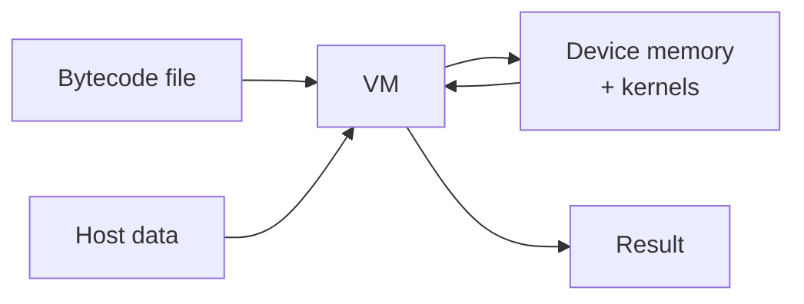
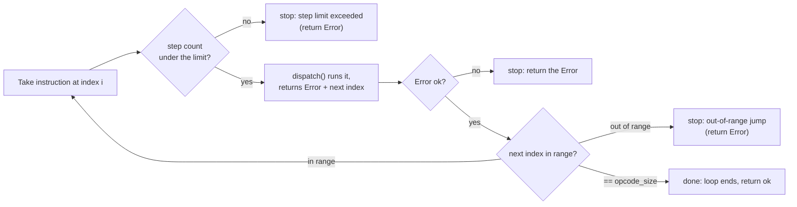
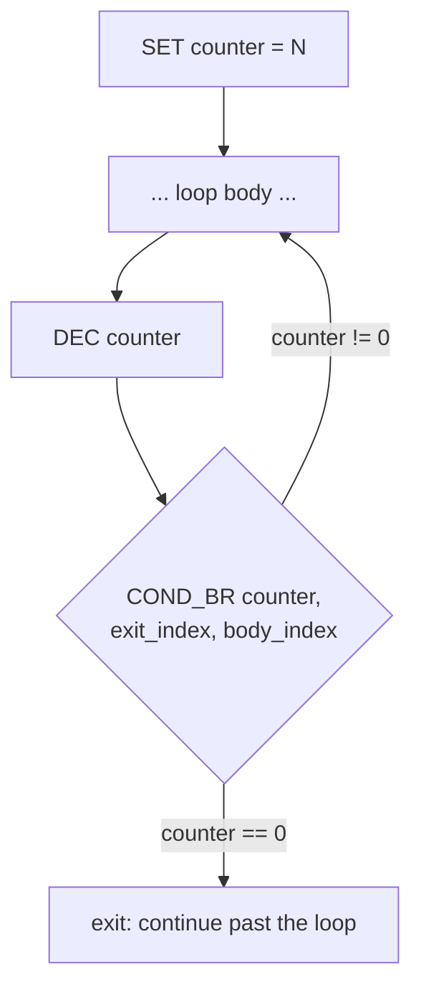
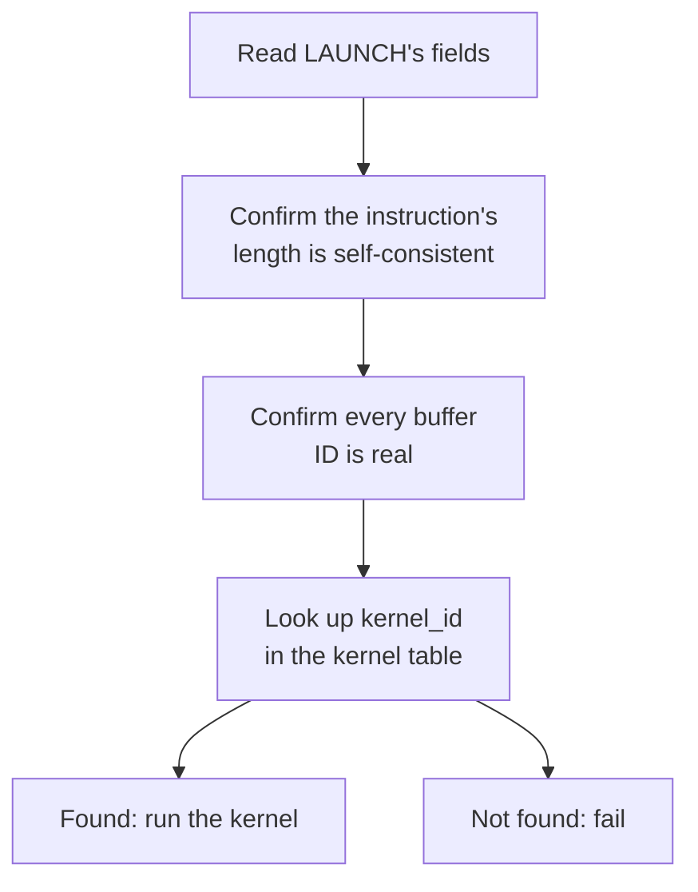

# A custom bytecode VM runtime

**A virtual machine that reads a hand-written bytecode file, interprets it instruction by instruction, and calls the real device APIs needed to hand heavy compute off to a device — a GPU, or the emulated NPU.**

This doc covers the bytecode format, how the interpreter turns a text file into real device memory and real kernel launches, and where it maps onto IREE's own architecture. No compiler exists here on purpose — the bytecode is written by hand, in plain text files. What's actually being built and tested is the runtime underneath it.

## Table of contents

1. [Mapping onto IREE](#mapping-onto-iree)
2. [What's implemented, at a glance](#whats-implemented-at-a-glance)
3. [Bytecode instruction set](#bytecode-instruction-set)
4. [Architecture](#architecture)
   - [4.1 Overview](#41-overview)
   - [4.2 Parsing the file](#42-parsing-the-file)
   - [4.3 Checking sizes before anything runs](#43-checking-sizes-before-anything-runs)
   - [4.4 Setting up input](#44-setting-up-input)
   - [4.5 Running the instructions](#45-running-the-instructions)
   - [4.6 Registers and indirect addressing](#46-registers-and-indirect-addressing)
   - [4.7 Control flow: BR and COND_BR](#47-control-flow-br-and-cond_br)
   - [4.8 Launching a kernel](#48-launching-a-kernel)
   - [4.9 Reading the result back](#49-reading-the-result-back)
5. [Error handling](#error-handling)
6. [Testing](#testing)
7. [Limitations](#limitations)
8. [Future direction](#future-direction)
9. [File structure](#file-structure)

## Mapping onto IREE

| IREE's version | This project's version |
|---|---|
| `.vmfb`'s VM bytecode section | A hand-written bytecode file, plain text |
| IREE's compiler, producing that bytecode | Not built. Bytecode is authored directly, by hand |
| IREE's VM interpreter | A VM/interpreter, built from scratch, that reads the bytecode file |
| IREE VM's register/value list, used to carry state between instructions | This VM's own register file — integer registers with ids 0 to 1023 |
| IREE VM's single branch primitive (its loops and conditionals are both built from just this) | `BR` / `COND_BR` — the same idea: jump forward or backward, optionally testing a register first |
| HAL — hardware-independent control flow, backend-specific executables underneath | `src/hal/device.h`'s abstract `Device` interface: `allocate`/`free`/`upload`/`download`/`dispatch`, implemented separately per backend |
| A driver (e.g. the CUDA driver) | `CudaDevice` (`src/hal/cuda_device.{h,cpp}`) — wraps real CUDA calls behind the `Device` interface |
| A compiled `hal.executable` (device machine code) | Real CUDA kernels (`vec_mm_Kernel`, `vec_add_Kernel`, `relu_Kernel`, `bias_add_Kernel`), what a CUDA-targeted `LAUNCH` instruction points at |

## What's implemented, at a glance

The first version of this VM could only run a straight-line list of five instructions: allocate memory, copy data in, launch one of two kernels, copy data out, free memory. Since then, three real capabilities have been added on top of that:

- **Registers.** Up to 1024 integer registers the bytecode can read and write (`SET`, `INC`, `DEC`). This is what makes anything below possible — without somewhere to keep a running value, there's no way to count, loop, or make a decision.
- **Indirect addressing.** Any **value** operand in the bytecode — a buffer handle, an input slot, a size, a `LAUNCH` argument — can be written as `@N` instead of a plain number, meaning "read register `N` right now and use that." (Id operands — register ids and jump targets — stay bare; see the note above the opcode tables.) The same line of bytecode can then touch a different buffer or slot on every pass through a loop.
- **Control flow.** `BR` (unconditional jump) and `COND_BR` (jump based on whether a register is zero). Together with registers, this is enough to build real loops — proven end to end in `src/test-bytecode/bytecode12.txt`, which runs a two-layer network by looping the same three-kernel block twice, picking each layer's own weights and bias through register-indexed buffer arguments.

Two more kernels were also added (`relu_Kernel`, `bias_add_Kernel`, on top of the original matmul and vector-add), and kernel chaining was proven: a kernel's output buffer can feed straight into the next kernel's input, with no host round trip in between.

Since then, a second, larger change has landed: **the VM no longer talks to CUDA directly.** Every hardware call — allocate, free, upload, download, launch — now goes through an abstract `Device` interface (`src/hal/device.h`), with CUDA's own logic relocated, unchanged in behavior, behind a `CudaDevice` implementation of it. A second implementation, `EmunpuDevice`, wraps `emunpu-sim` (a separately-built, simulated multi-core NPU, plain C, no GPU required) behind that same interface. The VM itself never knows which one it's talking to.

That second implementation has been run, not just built: `src/test-bytecode/bytecode12_emunpu.txt` (the same two-layer network as `bytecode12.txt`, with only its `LAUNCH` lines rewritten for emunpu's shape) produced `0 0 8 0` end to end via `src/main_emunpu.cpp` — the correct result. The CUDA side of the same comparison is still assumed correct rather than confirmed the same way, since this environment has no CUDA GPU to run it on. Full design reasoning — why this shape, what was tried and dropped, what's still open — lives in [`hal-design.md`](../bytecode-vm/hal-design.md); this doc covers what's actually built.

The rest of this doc describes the instruction set and pipeline in detail; §7's file structure reflects the current `hal/` split.

## Bytecode instruction set

Eleven opcodes now, not five. Every instruction is still one line: a name, then whitespace-separated operands. The VM doesn't know what a program "means" — it just runs these in order (or jumps, when told to).

**Operands.** An operand is written one of two ways:

- a plain **number**, e.g. `3`.
- a **register**, written `@N`, e.g. `@3` — read register `N` now and use the number inside it.

Every operand is one of two kinds. The **Kind** column in each table marks each one:

- **value** — the data the opcode works on. A value is a number, or a register that holds that number (`@N`). Example: a size, a handle, the number to store.
- **id** — a register id, or an instruction index (the line a `BR` or `COND_BR` jumps to). An id is always a plain number.

`@N` is allowed only on a **value**. `@N` on an **id** is a parse error.

Most opcodes take values, so they accept `@N` or a plain number. A few arguments (`BR`, `COND_BR`, `SET`, `INC`, `DEC`) are ids by design, for two reasons:

- A branch target is a fixed instruction index, so it is never read from a register (`BR`, `COND_BR` targets).
- `SET`, `INC`, `DEC`, and `COND_BR` already name a `reg_id` directly, so putting a `reg_id` inside another register would only add double indirection for no gain.

### Memory and host transfer

| Instruction | Operands | Kind | What it does |
|---|---|---|---|
| `ALLOC` | `size` | value | Allocates a device buffer of `size` bytes. The VM hands out the next free buffer ID (0, 1, 2...) on its own, and later instructions refer back to it by that number. |
| `FREE` | `buffer_id` | value | Releases the device buffer at `buffer_id`. The handle is data, so `FREE @4` frees the buffer whose handle sits in register 4. |
| `COPY_H2D` | `buffer_id`, `input_slot`, `size` | value, value, value | Copies `size` bytes from an input slot (set earlier by the host) into a device buffer. All three operands accept `@N`. |
| `COPY_D2H` | `output_slot`, `buffer_id`, `size` | value, value, value | Copies `size` bytes from a device buffer into an output slot, so the host can read it back. The order flips here — output slot comes first. All three operands accept `@N`. |

### Compute

| Instruction | Operands | Kind | What it does |
|---|---|---|---|
| `LAUNCH` | *backend-specific — see below* | all value | Runs compute. Every operand (op id, buffer handles, scalars) is a value, so each one accepts `@N`. Every other opcode in this table means the same thing regardless of which device the VM is running against; `LAUNCH` is the one exception, on purpose. |

`LAUNCH`'s exact shape depends on which `Device` is loaded — a CUDA-targeted bytecode file and an emunpu-targeted one encode it differently, and each backend refuses to run the other's format. CUDA's shape (the only one shown in the rest of this doc's examples): `kernel_id`, `num_buffers`, `buf0..bufN`, `grid_x/y/z`, `block_x/y/z`, `num_scalars`, `scalar0..` — a kernel id, the buffers it touches, a grid/block configuration, and scalar arguments. emunpu's shape has no grid or block at all (emunpu has no such concept) — `op_id`, `num_buffers`, `buf0..bufN`, `num_scalars`, `scalar0..` — see [`hal-design.md`](../bytecode-vm/hal-design.md) for the full mapping of `op_id`s to emunpu's own compute functions.

### Registers

| Instruction | Operands | Kind | What it does |
|---|---|---|---|
| `SET` | `reg_id`, `value` | id, value | Writes `value` into register `reg_id`. `reg_id` is an id (bare, no `@`); `value` accepts `@N`. So `SET 4 @3` writes the contents of register 3 into register 4. The register id must be from 0 to 1023. |
| `INC` | `reg_id` | id | Adds 1 to the register's current value. `reg_id` is an id — bare, no `@`. |
| `DEC` | `reg_id` | id | Subtracts 1. `reg_id` is an id — bare, no `@`. Nothing stops it going negative. |

### Control flow

| Instruction | Operands | Kind | What it does |
|---|---|---|---|
| `BR` | `target_index` | id | Unconditionally jumps execution to instruction `target_index`. The target is an id (an instruction index) — bare, no `@`. No register involved — just go there next. |
| `COND_BR` | `reg_id`, `if_zero_index`, `else_index` | id, id, id | Reads the register named by `reg_id`. If its value is exactly 0, jump to `if_zero_index`; otherwise jump to `else_index`. All three operands are ids — bare, no `@`. Note the asymmetry: `reg_id` is an id (the VM *reads* that register), but the two targets are also ids (instruction indices). This is the VM's only conditional — every loop is built from this one instruction plus a register counting down toward zero. |

### End of program

| Instruction | Operands | Kind | What it does |
|---|---|---|---|
| `EOF` | (none) | — | Halts the program cleanly. It sets the next index to one past the last instruction, so the execute loop ends and returns ok. It works anywhere, not only at the real end — an `EOF` in the middle stops execution of every line after it. |

## Architecture

### 4.1 Overview

One diagram covers the whole thing: a bytecode file goes in, a result comes out, and everything between is the VM.



Full diagram: [vm-architecture.excalidraw.svg](../vm-architecture.excalidraw.svg)

Inside that box, four parts each do one job:

- **Bytecode parser** turns the text file into a list of instructions.
- **VM** walks that list, keeps the register file, resolves jumps, and runs each instruction.
- **I/O handler** owns the boundary with the host: holds whatever data comes in, and whatever result goes out.
- **Device** — an abstract interface (`allocate`/`free`/`upload`/`download`/`dispatch`) the VM calls without knowing which hardware answers it. `CudaDevice` and `EmunpuDevice` each implement it their own way; what used to be a separate buffer manager and kernel registry are now relocated inside `CudaDevice` itself.

Each of the next eight sections is one step in that pipeline, roughly in the order it actually runs.

### 4.2 Parsing the file

The file is read one line at a time. Blank lines and comment lines (`//`) are skipped, not parsed into instructions. Every other line becomes one instruction — a name (`ALLOC`, `LAUNCH`, `COND_BR`) plus whatever arguments follow it on that line. Every argument is parsed into an `Arg`, which remembers whether it was written as a plain number or as `@N`:

```cpp
struct Arg {
    long value;
    bool is_register;   // true if this operand was written as @N
};

struct opcode {
    std::string name;
    std::vector<Arg> args;
    int line_number;
};
```

An argument token starting with `@` is stored with `is_register = true` and `value` set to the register number to read; anything else is stored as a plain literal. Parsing a number uses `strtol`, not `std::stoi` — `strtol` does not throw, so a bad token (`abc`, `16x`, an empty `@`) returns an `Error` instead of an uncaught exception. That choice matters: the whole runtime is built on `Error` returns, not exceptions (see §5), and `std::stoi` would be the one place that breaks that contract.

All of this gets collected into one `std::vector<opcode>` — the parsed program. The whole file is parsed up front, before any instruction executes. So parsing and execution are two separate phases: a syntax error anywhere in the file fails at load time, and `EOF` in the middle of a file (§4.7) stops *execution* of later lines, but does not stop them being *parsed*. By the end of this step, the whole program exists in host memory as that list. Nothing has touched the device yet, and no register has actually been read — that only happens once the VM runs the instruction.

### 4.3 Checking sizes against the signature

The old scan of `COPY_H2D` / `COPY_D2H` lines is gone (D14 step 3, 2026-11-11). The header declares each slot's name and size. The host binds it with `bindSignature` before the run.

- `setInput` and `getOutput` check the slot and the size against the header.
- `COPY_H2D` and `COPY_D2H` check the slot and the size when they run. A `@N` slot is checked at that time.
- Before the first instruction, every declared input must be set.
- After the last instruction, every declared slot must have been used (R12).

See [`validation-design.md`](../bytecode-vm/validation-design.md) and [`bytecode-contract.md`](bytecode-contract.md).

### 4.4 Setting up input

Before execution starts, the host hands the VM its input data. This step doesn't copy that data anywhere — it just remembers where the array is. A pointer, not a copy.

That pointer only stays valid as long as the original array stays alive for as long as the VM needs it.

### 4.5 Running the instructions

Execution used to be "take the next instruction, run it, move to the next one" — a straight line, always forward, always by one. That's no longer true. Now `dispatch()` hands back two things: an `Error` (ok, or a failure that stops the whole run — see §5), and, through an out-parameter, the index of whichever instruction should run next. Most instructions set "the one right after me." `BR` and `COND_BR` are the exception — they set whatever index they decide to jump to.



Two guards sit in this loop that were not there before. A **step counter** bounds how many instructions run in one `execute` call (`1e8` right now), so a runaway loop fails instead of hanging. And the **next index is range-checked** every pass: a negative or too-large index is a failure, while exactly `opcode_size` means "fell off the end" and ends the loop cleanly. This one change — index-plus-status out of `dispatch` — is what turns the VM from "run this list top to bottom" into something that can loop and branch. Everything in §4.7 is built on top of it.

### 4.6 Registers and indirect addressing

Registers are stored in a `std::unordered_map<int,int>` inside the VM, starting empty. A register id must be from 0 to `MAX_REGISTERS - 1` (1023); any other id is an error. `SET` creates or overwrites a register. Reading a register that was never set is an error, not 0. `INC` and `DEC` stop with an error instead of overflowing past `INT_MAX` or `INT_MIN`.

`INC` and `DEC` are both read-modify-write: read the current value, add or subtract 1, write it back. `DEC` doesn't stop at zero — it'll happily go negative if asked to.

Every **value** operand written as `@N` — not just in one opcode — gets resolved through this same register read at the moment its instruction runs; one helper, `resolveValue`, does the read for every opcode, so no handler reads `@N` on its own. (Id operands never carry `@N`, so they never pass through this read; `COND_BR`'s first operand is a register the VM reads directly with `readRegister`, not a `@N` resolve.) That's what lets a loop body do `COPY_H2D @0 @1 16`: as the registers change across passes, the exact same instruction line touches a different buffer or input slot each time. `bytecode12_emunpu.txt` uses this directly — its `LAUNCH 0 3 @0 @1 5 ...` picks each layer's own weight buffer through register-indexed arguments.

### 4.7 Control flow: `BR` and `COND_BR`

`BR` is unconditional — it just says "run instruction N next," with no register involved.

`COND_BR reg, if_zero, else` is the VM's only conditional, and every loop is the same shape built on top of it: set a counter, do the loop body, count the register down (or up) toward some value, then ask `COND_BR` whether it's hit zero yet.



`bytecode12_emunpu.txt` proves this end to end: its two-layer network is one loop body, run twice, picking layer 0's or layer 1's weights and bias through register-indexed `LAUNCH` buffer arguments. The loop counter counts down with `DEC`, and `COND_BR` jumps back to the body until it hits zero.

`EOF` now halts the program for real. It sets the next index to `opcode_size` — one past the last instruction — so the execute loop's condition ends and `execute` returns ok. This works mid-file too: an `EOF` on line 2 of a 6-line file stops lines 3–6 from ever running. Worth calling out the two-phase split here — those lines are still *parsed* at load time, so a syntax error after `EOF` still fails. `EOF` only ends *execution*.

### 4.8 Launching a kernel

A `LAUNCH` instruction is different from the fixed-length ones because its length isn't fixed. It carries a list of buffers and a list of scalar arguments, and both lists can be any length — so the instruction has to say how long it is as part of the instruction itself.



**Reading the fields.** The instruction starts with a kernel ID and a count of how many buffers follow. From that count, the VM works out exactly where the buffer list ends, and from there, where the grid and block numbers sit, and where the scalar arguments start. Once all of that's known, it checks the instruction's actual length matches what those counts predict. If a bytecode author wrote the wrong number of buffer IDs, this is where it gets caught — not later, as a broken pointer. Any of these fields — kernel id, buffer ids, grid/block numbers, scalars — may themselves be written as `@reg` and get resolved before this check runs.

**Checking the buffers.** Every buffer ID mentioned gets checked the same way `COPY_H2D` checks one: does it exist, has it not been freed. Same check every time, regardless of which kernel is about to run.

**Finding the kernel.** Every kernel gets registered ahead of time under a small integer ID, inside whichever `Device` is loaded — this used to live in a standalone `KernelRegistry` class; that logic now lives directly inside `CudaDevice`. Launching one is a lookup — take the ID out of the instruction, find the matching entry, hand off to it. Unregistered ID, the instruction fails cleanly instead of running whatever happens to sit at that number.

**Running it.** Four kernels are registered right now:

| `kernel_id` | Kernel | Buffers | Scalars | What it computes |
|---|---|---|---|---|
| 0 | `vec_mm_Kernel` | x, y, z | n, width, height | `z = x @ y` (matrix multiply) |
| 1 | `vec_add_Kernel` | x, y, z | n | `z = x + y`, elementwise |
| 2 | `relu_Kernel` | x, z | n | `z = max(x, 0)`, elementwise |
| 3 | `bias_add_Kernel` | x, bias, z | n, out_features | `z = x + bias`, bias broadcast per output column |

All four happen to take the same *shape* of arguments — some number of buffers, then some number of plain numbers — so all four go through one shared piece of launch code instead of four hand-written ones. That shared code checks the exact buffer/scalar count the specific kernel expects, resolves each buffer ID into a real device address, reads the scalar arguments, and starts the kernel running.

**Why the explicit wait.** Launching a kernel isn't instant. The device starts running it and immediately hands control back, so right after the launch, the VM explicitly waits for the kernel to finish and checks whether anything went wrong during that run. Skip that wait, and the VM moves on to the next instruction before the kernel's actually done.

**Kernel chaining, proven.** Nothing requires a `LAUNCH`'s output to go back to the host before the next `LAUNCH` uses it. `bytecode12_emunpu.txt` relies on this directly: a matmul's output buffer is passed straight in as the next kernel's input buffer, with no `COPY_D2H`/`COPY_H2D` in between — the intermediate result never leaves the device.

Adding a new kernel of the same shape is a short registration, not new logic — define the kernel function, then register it in `kernel_table` under a new ID.

### 4.9 Reading the result back

Once `execute` returns ok, whatever the last `COPY_D2H` wrote is sitting in an output slot, waiting. The host asks for it by slot number, the VM checks that slot was actually written and the size matches, then hands the data over.

**Why the write check matters.** A `COPY_D2H` prepares the output slot (grows and sizes it) *before* the download runs. If the download then fails, the slot exists but holds garbage. So each slot carries a `written_ok` flag, set true only after a clean download, and `getOutput` refuses a slot that is not `written_ok`. A failed run can never hand back a slot full of garbage as if it were a real result — the `Error` path (§5) stops the host from reading it in the first place, and this flag is the second line of defence.

## Error handling

**Every operation that can fail returns a status, the caller checks it, and the first failure stops the whole run.** This replaced an earlier model where a helper printed a message and execution carried on past the error.

**Why not exceptions.** The two systems this runtime models itself on both ban them: IREE's runtime is C and runs on `iree_status_t`, and LLVM builds with `-fno-exceptions` and uses `llvm::Error`/`Expected`. There's also a hard reason — `emunpu-sim` is C, and you cannot throw a C++ exception across a C boundary. A status return works on both sides of it; an exception does not. So the runtime uses checked status returns everywhere, and the one place that used to throw (`std::stoi` in the parser) is now `strtol`.

**The `Error` type.** A small struct in `src/error.h`, built only through two helpers so every call site reads the same:

```cpp
struct Error {
    std::string msg;
    bool ok;
    int line_number;
};

Error makeError(const std::string& msg, int line);   // a failure
Error ok();                                           // success
```

**The anti-ignore macro.** A plain `bool` is easy to drop — the old bug was exactly that, a device result thrown away. The fix is one macro that makes a dropped error impossible to write:

```cpp
#define RETURN_IF_ERROR(expr)            \
    do {                                 \
        Error _status = (expr);          \
        if(!_status.ok) return _status;  \
    } while(0)
```

It runs the call once, and if it failed, returns that same `Error` — with its real message and line — up to the caller. Each fallible call becomes one line that cannot silently continue. The `do { } while(0)` wrapper is the standard trick that lets a multi-line macro act as a single statement.

**How a failure travels.** The `Error` bubbles up untouched, layer by layer, until one place prints it:

```
emunpuDevice::upload   -> makeError(...) on failure, ok() on success
       ^ Error
VM::copyHostToDevice   -> RETURN_IF_ERROR(device->upload(...))
       ^ Error
VM::dispatch           -> RETURN_IF_ERROR(copyHostToDevice(...))
       ^ Error
VM::execute            -> stops the loop, returns the Error
       ^ Error
main (run() helper)    -> one check, report(e) once, non-zero exit
```

Each layer either forwards the error through the macro, or returns `ok()` at the end. Only the top — the `run()` helper in `main_emunpu.cpp` — calls `report()` and sets the exit code. That is the single stop point.

**Two-value returns.** Two functions have to return a status *and* a value: `allocate` (the status plus a device handle) and `dispatch` (the status plus the next instruction index). Both use an out-parameter — `Error f(..., T& out)` — so they still return `Error` and still work with `RETURN_IF_ERROR`, instead of a struct the caller would have to unpack by hand.

**The C boundary rule.** The device layer reads `emunpu-sim`'s `emunpu_status_t` and converts it to an `Error` right there. No raw `emunpu_status_t` ever travels above the device layer.

**Where each check lives.** A check that is true for any device goes in the VM; a check specific to one device stays in that device. For example, `ALLOC` with a size `<= 0` is rejected in the VM (wrong for any backend), while "size must be a multiple of 4" lives in the emunpu device, because that constraint only exists because emunpu commits every allocation to fp32.

**Constructor failure.** A C++ constructor cannot return an `Error`. So `emunpuDevice` records a failed `emunpu_device_create` by leaving its device pointer null, exposes `Error status()`, and the host checks it before running anything. Every device method also guards the null pointer, so a missed check still fails cleanly instead of dereferencing null.

**One caveat.** This describes the emunpu path, which is converted end to end. `src/main.cpp` (the CUDA entry point) still uses the old pre-`Error` calling style and is not converted yet — see §8.

## Testing

**A small runner plus a folder of one-case-each bytecode files, judged by a naming rule.** The runner (`src/test_runner.cpp`) takes one bytecode filename, sets generic inputs, runs the VM on the emunpu device, and prints a verdict. It decides the expected outcome from the file name: a file named `err_*` must return an `Error`, a file named `ok_*` must return ok. So `PASS` always means "behaved as the name promised," and one binary checks every case with no per-test C++.

`run_all.sh` runs a whole folder and prints one line per test — `PASS`/`FAIL`, the name, and a short detail. The noisy device logs go to `detail.log`, so the summary stays readable.

There are two folders:

| Folder | What it covers |
|---|---|
| `src/test-bytecode/tests/` | The normal surface: parser, opcodes, program end, alloc/free, copy, registers, control flow, LAUNCH and real kernel compute, and a small end-to-end matmul→relu program. |
| `src/test-bytecode/stress/` | Production-style attacks: integer overflow, resource exhaustion against the real device limit (256 MB global memory, the default capacity our runtime gets), size-contract violations, adversarial text (CRLF, embedded NUL, 10000-arg lines), and a real 16×16 MMA tile. |

**Probe tests.** Some files are deliberate probes — their correct outcome is not known in advance, and a `FAIL` on one may mean a real gap *or* a wrong guess in the name. Both are findings. Each folder's `README.md` marks these and records the gaps most likely to be real: the parser does not stop on `strtol`'s `ERANGE`, so an overflowing number is clamped; and the VM checks a copy's size against the host slot but not against the device buffer's own allocated size. (The `INC`/`DEC` overflow guard has been added since.)

This section closes the "deliberate error-path testing" gap that earlier versions of this doc listed as not-yet-done.

## Limitations

- No compiler. Bytecode is hand-written, so a malformed instruction is a human mistake, not something the toolchain would catch ahead of time.
- Kernel arguments go through `cudaLaunchKernel`'s `void**` interface rather than a typed call, which means a wrong argument type or order is no longer caught by the compiler — only at runtime, if at all.
- The shared launch path only covers kernels shaped as "some buffers, then some plain numbers." A kernel needing a different argument type needs its own launch code.
- The CUDA path only runs against real CUDA — no local GPU to test against directly, hence a remote Kaggle GPU instance. This is exactly the gap `EmunpuDevice` (see [Future direction](#future-direction)) exists to close: a hardware target that needs no GPU at all.
- The static size check (§4.3) can't see through `@reg` indirect addressing. Any `COPY_H2D`/`COPY_D2H` whose slot is register-based silently skips the pre-run check and is only validated when it actually executes.
- No function calls or subroutines. Repeating a sequence still means either writing it twice, or looping it with `COND_BR` — which only supports "repeat the same block," not "call this block from several different places and come back."
- No type system for buffers. A buffer is just N raw bytes as far as the VM is concerned — nothing records whether it holds floats, ints, or anything else. Whichever kernel reads it just assumes a type. This is fine while every kernel agrees on `float*`, but it's a real gap against hardware that tracks data types itself — `EmunpuDevice` currently papers over this by committing every allocation to `EMUNPU_DT_FP32` (see [`hal-design.md`](../bytecode-vm/hal-design.md) §8).
- A copy's size is checked against the host input slot, but not against the device buffer's own allocated size. Uploading more bytes than a buffer holds is not caught in the VM layer — only by the device, if it catches it at all. The planned `BufferTable` closes this ([`validation-design.md`](../bytecode-vm/validation-design.md)).
- The parser's number conversion detects `strtol`'s `ERANGE` but only prints a message; it does not return an error. A number that does not fit in an `int` is not rejected either.
- The `ALLOC` handle returned by the device is captured but not stored. The VM still assumes a buffer's handle equals its allocation order, which happens to hold for emunpu but is not guaranteed. The planned `BufferTable` stores it ([`validation-design.md`](../bytecode-vm/validation-design.md)).
- LAUNCH dimensions are not checked against buffer sizes. A wrong `M`, `N`, `K` or `count` makes the kernel read or write past its buffer.

## Future direction

Two structural gaps from the first version of this doc — control flow, and kernel chaining without a host round trip — are done now (§4.7 and §4.8). What's left:

**Validation architecture (D14).** One struct for all limits, a load-time verifier, a declared `.input` / `.output` signature, and a VM buffer table. The design is in [`validation-design.md`](../bytecode-vm/validation-design.md). The bytecode format the compiler must emit is in [`bytecode-contract.md`](bytecode-contract.md).

**Function calls.** Still the most IREE-like addition left. Right now, running the same sequence of instructions from two different places in a program means writing it twice, or reshaping the whole thing into one loop. A `CALL`/`RETURN` pair would let a block be defined once and invoked from multiple places, returning to wherever it was called from — genuinely different from `COND_BR` looping back to a fixed point.

**A debug/print instruction.** Lets someone hand-writing bytecode inspect a buffer's contents mid-run without editing the host harness and recompiling.

**Device selection and the CUDA path.** The emunpu path is converted to the `Error` model and run end to end. `src/main.cpp` (CUDA) is not — it still uses the old pre-`Error` calling style. Two things are left here: convert `main.cpp`, and replace the two hand-maintained entry points with one that selects the device at startup (a flag, or a `.target` line in the bytecode).

**Multi-hardware support — implemented and confirmed on one backend.** The VM no longer assumes CUDA anywhere in its own code (`vm_core.cpp` has zero CUDA in it) — it talks only to an abstract `Device` interface. Two implementations exist: `CudaDevice`, wrapping the same CUDA logic this VM always had, and `EmunpuDevice`, wrapping `emunpu-sim` — a separately-built, simulated multi-core NPU (plain C11, no GPU, no CUDA toolchain needed). Since the two devices work at genuinely different levels (CUDA's `LAUNCH` needs a grid/block, emunpu's doesn't and shouldn't pretend to), bytecode is *target-specific*: a CUDA-targeted file and an emunpu-targeted file compute the same thing but encode `LAUNCH` differently — every other opcode is identical between them. `src/test-bytecode/bytecode12_emunpu.txt` is that emunpu-targeted equivalent of `src/test-bytecode/bytecode12.txt`, run end to end via `src/main_emunpu.cpp`, and it produced `0 0 8 0` — the correct result, matching the CUDA version's expected output exactly. The CUDA side of that same comparison is still only assumed correct, not yet confirmed the same way: it needs a run on a real CUDA GPU (Kaggle, since this environment has none), which hasn't happened yet. The full reasoning — why target-specific bytecode over a shared format, the handle-translation contract, what happens when emunpu is missing an operation, how this maps onto IREE's own HAL/executable split — lives in [`hal-design.md`](../bytecode-vm/hal-design.md), kept up to date as each piece lands.

## File structure

| File | Role |
|---|---|
| `src/bytecode.{h,cpp}` | Parses the `.txt` bytecode file into instructions, including `@reg` indirect operands |
| `src/vm_core.{h,cpp}` | The dispatch loop, the register file, jump resolution, and the copy helpers — holds a `Device*`, hardware-neutral, zero CUDA |
| `src/io_handle.{h,cpp}` | Input/output slots, the host-facing boundary, and the per-slot `written_ok` flag |
| `src/error.h` | The `Error` struct, the `makeError`/`ok`/`report` helpers, and the `RETURN_IF_ERROR` macro — used everywhere (see §5) |
| `src/main.cpp` | The CUDA entry point — constructs a `CudaDevice` and runs `bytecode12.txt`. Not yet converted to the `Error` model (§8) |
| `src/main_emunpu.cpp` | The emunpu entry point — constructs an `EmunpuDevice`, runs `bytecode12_emunpu.txt` through a `run()` helper, and reports once in `main`. A separate hand-maintained file for now; §8 covers replacing it with real device selection |
| `src/hal/device.h` | The abstract `Device` interface: `name`/`allocate`/`free`/`upload`/`download`/`dispatch`, all returning `Error`. No CUDA or emunpu anywhere in this file, on purpose |
| `src/hal/cuda_device.{h,cpp}` | `CudaDevice` — real CUDA calls behind `Device`. What used to be `buffer_manager.*` and `kernal_registry.*` now lives here |
| `src/hal/emunpu_device.{h,cpp}` | `EmunpuDevice` — wraps `emunpu-sim`'s API behind the same `Device` interface. Run end to end; see [What's implemented](#whats-implemented-at-a-glance) |
| `src/hal/kernels.{h,cu}` | Real CUDA kernel definitions: `vec_mm_Kernel`, `vec_add_Kernel`, `relu_Kernel`, `bias_add_Kernel`. Lives here, not at the top level of `src/`, since `CudaDevice` is its only caller |
| `src/test_runner.cpp` | The test harness (§6) — takes one bytecode filename, runs it, prints a PASS/FAIL verdict by the file's name |
| `src/test-bytecode/bytecode12.txt` | The CUDA-targeted example program: a two-layer network, chained and looped, matching `src/main.cpp` |
| `src/test-bytecode/bytecode12_emunpu.txt` | The same network, emunpu-targeted, matching `src/main_emunpu.cpp` — identical to `bytecode12.txt` outside the `LAUNCH` lines |
| `src/test-bytecode/tests/` | One-case-each test bytecode files for the normal surface, plus `run_all.sh` and a `README.md` (§6) |
| `src/test-bytecode/stress/` | Production-style stress and adversarial test files, plus their own `run_all.sh` and `README.md` (§6) |
| [`hal-design.md`](../bytecode-vm/hal-design.md) | The design document for the `Device` split — sits alongside `src/`, not inside it |
| [`validation-design.md`](../bytecode-vm/validation-design.md) | D14: where each limit, slot, size and buffer check lives, and the migration plan |
| [`bytecode-contract.md`](bytecode-contract.md) | The bytecode format agreed with the compiler team (draft v0.1) |

Both entry points load their bytecode file by a relative path (`bytecode12.txt`), so each needs its working directory pointing at the folder holding that file (`src/test-bytecode/`), or the file copied alongside wherever the compiled binary runs. The same applies to `test_runner`, which takes the path as an argument.
